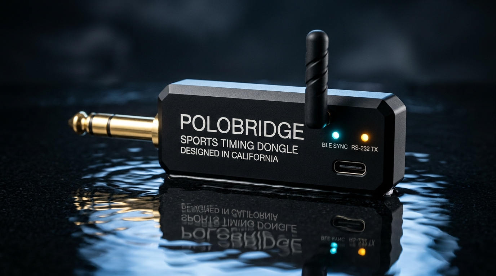
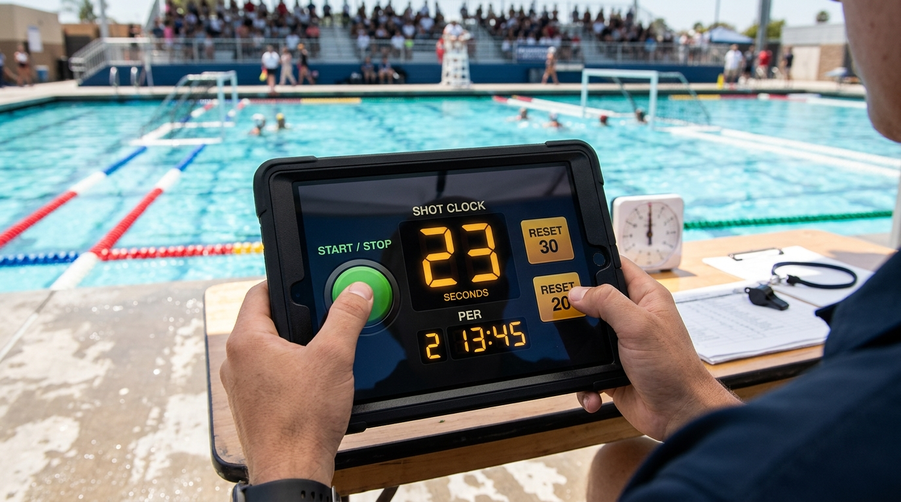
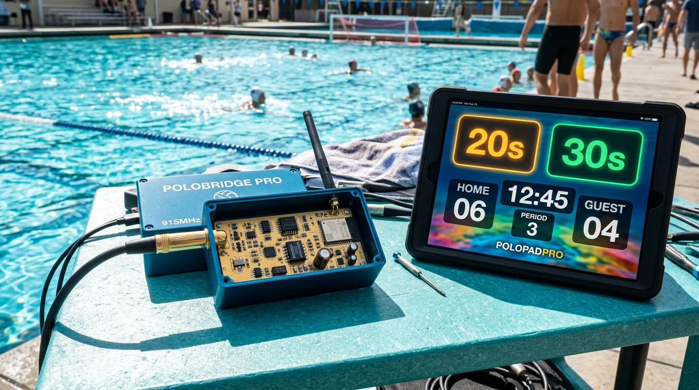

# PoloBridge & PoloPad Pro

**Wireless iOS/iPadOS & Web Bluetooth Water Polo Timing Console + 2.5kV Isolated RS-232 Scoreboard Hardware Bridge**

[](https://peternunley08-ops.github.io/polobridge/)
[](./ipad_app)
[](./hardware/jlcpcb_production)
[](./hardware/enclosure_cad)

> ### 📱 Open Live on Your iPad / iPhone Right Now (Zero Localhost Required)
> **Live Public HTTPS Console:** **[https://peternunley08-ops.github.io/polobridge/](https://peternunley08-ops.github.io/polobridge/)**
> - **Install as Full-Screen Offline iOS App**: Open the URL above in Safari (or **Bluefy** for Web Bluetooth) → tap **Share** → **Add to Home Screen**. Includes an offline Service Worker (`sw.js`) so the console runs 100% offline on concrete pool decks with zero Wi-Fi/cellular signal.

**PoloBridge (Rev 2.5)** replaces aging \$4,500+ aquatic timing consoles (**Colorado Time Systems System 6**, **Daktronics All Sport 5000**) and failure-prone \$165 wired "pickle switches" with **PoloPad Pro**—a sunlit Olympic Pool high-contrast iPad/Web console paired with a **\$24–\$50 open-hardware Bluetooth LE-to-RS232 + 3-Channel Isolated Pickle bridge dongle** (or a **\$279 Turnkey School Kit**).

---

## Visual Showcase

| Hardware Dongle (IP67 Enclosure) | Poolside iPad Operator POV | Complete Kit Exploded CAD Render |
| :---: | :---: | :---: |
|  |  |  |

---

## System Architecture

```mermaid
flowchart LR
    subgraph iPad["PoloPad Pro (iOS / iPadOS / Web PWA)"]
        UI["Tactile 3D Plunger Deck\n(30s / 20s / Fouls / Timeouts / PSO)"]
        RE["Water Polo Rules Engine\n(WP 20.15 Blank | WP 21 Goal Release | WP 22.3 Cap-Out)"]
        SIX["6-8 Sports Live Sync\n(Roster + Bi-Directional Box Score)"]
        BLE_TX["CoreBluetooth / WebBLE Central\nUUID: 4fa10001-8a2b-..."]
        UI --> RE
        RE <--> SIX
        RE --> BLE_TX
    end

    subgraph Dongle["PoloBridge Hardware Dongle ($24–$50)"]
        MCU["ESP32-S3-WROOM-1U\n10Hz Deterministic Loop"]
        ISO["2,500V RMS Galvanic Isolator\n(ADM3251E / ADuM1201 + B0303S)"]
        RS232["MAX3232E (±12V RS-232)\n+ ±15kV Bourns TVS Clamp"]
        OPT["TLP175A / PC817 Optocoupler\n(150ms Pickle Relay Closure)"]
        MCU --> ISO --> RS232
        MCU --> OPT
    end

    subgraph PoolDeck["Existing Pool Deck Infrastructure"]
        WA3["CTS WA-3 2.4GHz Wireless\nor Brass Deck Plate Jack"]
        SYS6["CTS System 6 / Daktronics\nAll Sport 5000 (Code 4498)"]
        CLOCKS["CTS SC-500 / SC-600\nLED Shot Clocks & Matrix Board"]
        WA3 --> CLOCKS
        SYS6 --> CLOCKS
    end

    BLE_TX == "BLE 5.0 GATT (<4ms)" ==> MCU
    RS232 == "1/4\" TS Jack (9600 8-E-1 / 19200 8-N-1)" ==> WA3
    OPT -. "1/4\" TS Pickle Port" .-> SYS6
```

---

## Key Capabilities

1. **Dual-Button 30s & 20s Tactile Plungers (Zero Double-Tap Errors)**
   - Dedicated **Emerald `30s FULL RESET`** (turnover/goal/new possession) and **Amber `20s EXCLUSION / REBOUND`** (corner throw, offensive rebound, or major foul) eliminate the #1 high school & collegiate table error.
2. **Complete World Aquatics (FINA), NCAA & NFHS Rules Engine**
   - **Rule WP 20.15 Auto-Blanking**: Automatically sends `0x20 0x20` ASCII blanking spaces to physical LED shot clocks whenever `gameClock < shotClock` at the end of a period.
   - **Rule WP 21.11 Automatic Exclusion Release on Goal**: Scoring a goal automatically clears the defending team's active 20-second exclusion timers while keeping personal foul tallies intact.
   - **Rule WP 22.3 3-Foul "Rolled / Capped-Out" Enforcement**: Tracks personal major fouls (`1` → `2` → `3 ROLLED OUT`) per cap number (`#1`–`#15`), triggers red cap-out alerts, and prevents illegal 4th exclusions.
   - **Team Timeouts (`60s FULL` & `30s SHORT`)**: Pauses match and shot clocks, runs a dedicated timeout countdown on the console, fires a **15-second warning horn** at `0:15`, and sounds a double air-horn at `0:00`.
   - **Overtime (`OT1` / `OT2`) & Penalty Shootout (`PSO`) Scorecard**: 1-click transition to 3:00 golden/full overtime periods and an interactive 5-round + Sudden Death alternating shootout tracker.
   - **15-State Full Match Undo Stack**: Restores game clock, shot clock, scores, period, active exclusions, personal foul counts, and timeout counters with a single click (`[Z]` hotkey).
3. **6-8 Sports Game Desk Integration & Printable Official Scoresheet**
   - Sync official team rosters by cap number (`#1`–`#15`), stream live play-by-play telemetry (`GOAL`, `EXCLUSION`, `TIMEOUT`, `PERIOD_END`) to the 6-8 Sports cloud queue, and print or save a **1-Click Official Match Scoresheet PDF**.
4. **3-Way iOS / iPadOS & Cross-Platform Deployment**
   - **iOS Standalone PWA**: Open on any iPad in Safari or Bluefy BLE Browser → *Share → Add to Home Screen*.
   - **Capacitor Native iOS App**: Build for App Store / TestFlight via `@capacitor-community/bluetooth-le` (`react_app/capacitor.config.ts`).
   - **Pure Native SwiftUI App**: Compile directly from `Package.swift` and `ipad_app/` with zero external dependencies.

---

## Ready-to-Order Hardware Dongle BOM Summary

Full wiring schematics, pinouts, and assembly steps are in **[`firmware/HARDWARE_WIRING.md`](./firmware/HARDWARE_WIRING.md)** and **[`MASTER_PLAN_AND_BOM.md`](./MASTER_PLAN_AND_BOM.md)** (or use the interactive **Hardware BOM & Order** tab inside the web app to export a 1-click DigiKey CSV cart).

| Build Tier | Target Use Case | Isolation & Protection | Enclosure | Total Unit Cost |
| :--- | :--- | :--- | :--- | :---: |
| **Tier 1: DIY Prototype** | High School / Club Table (WA-3 Wireless Adapter) | Standard `MAX3232CSE+` + `PC817C` Optocoupler | Hammond `1591XXBSBK` ABS | **$24.40** |
| **Tier 2: Pro Commercial** | NCAA / Championship Deck Plates & Wet Environments | **2,500V RMS Isolated** (`ADM3251EARWZ`) + **±15kV TVS** (`CDSOD323-T15SC`) | **Hammond `1554C2GYCL` IP67** | **$49.85** |

---

## Quick Start

### 1. Launch the PoloPad Pro Web & iOS PWA Console (`react_app/`)

```bash
cd react_app
npm install
npm run dev      # Starts live server on http://localhost:3000
npm run build    # Verifies TypeScript + production bundle in react_app/dist/
```

The web console includes **5 built-in interactive modes** in the top navigation bar:
1. **Product & ROI** (`landing-page.tsx`) — Interactive product showcase, mini test console, RF physics breakdown, and multi-pool Athletic Director ROI calculator.
2. **Live Console** (`App.tsx`) — Full sunlit Olympic Pool operator desk with 100ms clocks, 3D plungers, timeouts, `OT1`/`OT2`, `PSO` shootout tracker, keyboard hotkeys (`[Space]`, `[R]`, `[E]`, `[H]`, `[Z]`), and live RS-232 hex frame inspector.
3. **Hardware BOM & Order** (`hardware-bom-panel.tsx`) — Filterable Tier 1 ($24.40) & Tier 2 Pro ($49.85) parts table with DigiKey/Mouser/Amazon SKUs, 1-click CSV export, and interactive 5-step assembly checklist.
4. **3D Studio & Blueprints** (`mockups-gallery.tsx`) — Photorealistic studio renders, iPad vs. Dongle split-view, **2.5kV Isolated 4-Layer PCB Blueprint**, and Deck Topology diagram.
5. **6-8 Sports Sync** (`six-eight-panel.tsx`) — Official roster import, cap-number assignment, and live box-score cloud sync.

### 2. Build the Native SwiftUI iPad App (`ipad_app/`)

```bash
# Run Swift Package Manager build & tests
swift test

# Or open Package.swift directly in Xcode 15+ on macOS:
open Package.swift
```

### 3. Flash the ESP32-S3 Dongle Firmware (`firmware/`)

```bash
cd firmware
pio run -e esp32-s3-devkitc-1 -t upload
```

---

## Repository Structure

```text
polobridge/
├── MASTER_PLAN_AND_BOM.md          # Complete Engineering Master Plan, Protocol Spec & BOM
├── Package.swift                   # Swift Package Manager manifest for iOS 16+ / macOS 13+
├── assets/                         # 4K Studio Hardware Renders & Exploded Kit Diagrams
│   ├── polobridge_hardware_dongle.jpg
│   ├── polobridge_deck_operator_pov.jpg
│   └── polobridge_kit_exploded_render.jpg
├── firmware/                       # ESP32-S3 BLE 5.0 to RS-232 Firmware & Schematics
│   ├── polobridge_firmware.ino     # 10Hz CTS (9600 8-E-1) & Daktronics frame generator
│   ├── platformio.ini              # PlatformIO build config
│   └── HARDWARE_WIRING.md          # Tier 1 ($24.40) & Tier 2 ($49.85) BOM + 2.5kV Schematic
├── ipad_app/                       # Native SwiftUI iPadOS Application
│   ├── PoloPadApp.swift            # App entry point
│   ├── PoloPadView.swift           # Sunlit Olympic Pool 3D tactile deck UI
│   ├── WaterPoloGameModel.swift    # World Aquatics / NCAA / NFHS rules engine
│   ├── BluetoothManager.swift      # CoreBluetooth Central driver (4fa10001-...)
│   └── Info.plist                  # iPadOS Landscape + CoreBluetooth permissions
├── react_app/                      # React 18 + TypeScript + Tailwind WebBLE / iOS PWA App
│   ├── capacitor.config.ts         # Native iOS Xcode wrapper configuration
│   ├── public/manifest.json        # iOS Standalone Home Screen WebApp manifest
│   └── src/
│       ├── App.tsx                 # Main operator console, rules engine & printable scoresheet
│       ├── components/
│       │   ├── landing-page.tsx        # Commercial Landing Page & ROI Calculator
│       │   ├── hardware-bom-panel.tsx  # Ready-to-Order BOM, DigiKey CSV export & schematic
│       │   ├── mockups-gallery.tsx     # 3D Studio Renders & 4-Layer Isolated PCB CAD Blueprint
│       │   └── six-eight-panel.tsx     # 6-8 Sports Game Desk Roster & Telemetry Sync
│       └── utils/
│           ├── bluetooth-manager.ts    # Web Bluetooth GATT + CTS & Daktronics packet builder
│           ├── sound-engine.ts         # Web Audio API Horn, Whistle & Plunger Synthesizer
│           └── six-eight-sports.ts     # 6-8 Sports API client & play-by-play queue
├── simulator/index.html            # Standalone single-file HTML/JS hardware simulator
├── tests/                          # Python & XCTest rules engine verification suites
└── tools/cts_packet_sniffer.py     # Live USB-to-RS232 CTS packet sniffer & decoder
```
